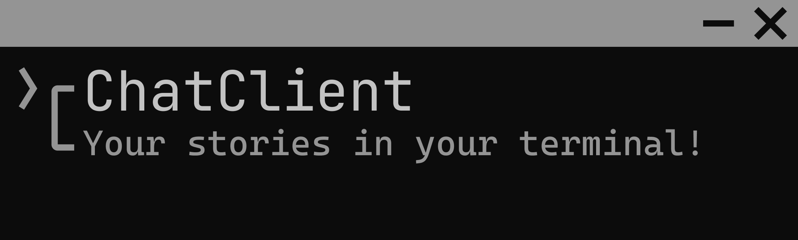

# ChatClient — documentation

**Quick links:**
[Keys](#typing-and-keys) ·
[Chats](#chats) ·
[Replies](#replies) ·
[Models](#models-and-providers) ·
[Characters](#characters-and-personas) ·
[Content & privacy](#content-and-privacy) ·
[Memory](#memory) ·
[Pictures](#pictures) ·
[Files](#files-import-and-export) ·
[Look & language](#look-and-language) ·
[Starting the app](#starting-the-app)

Everything the app can do, by topic. Installation is in [SETUP.md](SETUP.md); the
protocol for other front ends is in [PROTOCOL.md](PROTOCOL.md). Inside the app, `/help`
lists the commands and **Ctrl+P** opens a searchable command palette.

## Typing and keys

| Key | Does |
|---|---|
| Enter | send |
| Alt+Enter | new line in the same message |
| Ctrl+C | stop the reply being written (what was written is kept) |
| Alt+← / Alt+→ (or Ctrl+← / Ctrl+→), on an empty line | previous / next version of the last reply; past the newest, a new one is written |
| Ctrl+P | command palette |
| Ctrl+D or `/quit` | exit |

An unsent message is kept as a draft and comes back the next time you open the chat.
Actions written between asterisks (`*smiles*`) are shown in their own style.

## Chats

| Command | Does |
|---|---|
| `/new [title]` | start a new chat |
| `/sessions` | list chats |
| `/switch [id]` | switch chat (a list to pick from without an id) |
| `/rename <title>` | rename this chat |
| `/delete <id>` | delete a chat |
| `/history [n]` | show the last n messages (with their pictures) |
| `/search <text>` | search this chat (`/search --all <text>`: every chat) |
| `/export [md\|html\|txt\|jsonl]` | save the chat; `jsonl` can be imported again anywhere |
| `/copy [all]` | copy the last reply (or the whole chat) to the clipboard |

## Replies

| Command | Does |
|---|---|
| `/regen [provider:model]` | write a new version of the last reply (optionally with another model, just this once) |
| `/prev`, `/next` | step through the versions of the last reply |
| `/continue` | let the character carry on where the reply stopped |
| `/edit` | change your last message and get a new reply (`/edit reply`: fix the character's reply by hand) |
| `/undo` | take back the last exchange |
| `/ooc <message>` | talk to the AI out of character (about the story, not in it) |

Two things happen on their own: a reply the model **declined** is rewritten by the
fallback model (`/fallback`), and a reply that mostly **repeats** earlier ones is
written again once. The earlier version stays available with `/prev`.

## Models and providers

| Command | Does |
|---|---|
| `/model [provider:model]` | change the chat model (a list without a name) |
| `/models` | list the models of every provider |
| `/providers` | the configured providers |
| `/free` | find a free OpenRouter model that works right now |
| `/key [set\|remove] <provider>` | manage API keys (kept in the system keychain) |
| `/utility [provider:model\|chat\|reset]` | the model for background work (memory, picture prompts); a fast, cheap one is best |
| `/fallback [provider:model\|off]` | the model that rewrites declined replies |
| `/set [name value]` | generation settings for this chat, e.g. `/set temperature 0.9`, `/set max_tokens 600` |
| `/system [text]` | this chat's system prompt (in character chats: the narration rules) |

## Characters and personas

| Command | Does |
|---|---|
| `/char` | which character this chat is with |
| `/char list` | all characters |
| `/char new` | create one step by step: content setting, age, look, personality, history, who leads, themes; the AI can write the opening scene |
| `/char <name>` or `/char use [name]` | start a chat with a character |
| `/char show [name]` | show the card |
| `/char edit` | edit every field |
| `/char ai [first_mes\|mes_example\|description]` | let the AI rewrite one field |
| `/char lead follow\|balanced\|lead` | who drives the story: you, both, or the character |
| `/char color <#rrggbb\|auto>` | the colour of the character's name |
| `/char export [name] [card]` | a .zip with the card, chats, memory and pictures (`card`: the card alone) |
| `/char import <file>` | a .zip, a folder, or a community card (.json / .png) |
| `/char delete <name>` | delete a character and its chats |
| `/persona [set\|clear\|export\|import <file>]` | who you are, for the characters (name, age, description) |

Characters live in `characters/<name>/` as plain files (`card.json`, `chats/`,
`memory.jsonl`, `images/`); `/open` shows the folder.

## Content and privacy

| Command | Does |
|---|---|
| `/content standard\|mature` | mature: adult fiction without lectures or disclaimers (set per character when chatting with one) |
| `/private [on\|off]` | nothing from this chat is remembered, indexed or recalled elsewhere; what memory took from it is deleted |

Mature characters must have a stated age of 18 or older; every character in sexual
content is an adult, and pictures follow the same rule.

## Memory

The character remembers across all your chats with it: facts, events, plans, how you
relate, what happened on which day. It notices contradictions ("but you said…"), checks
claims about the past, and keeps the story so far once early messages no longer fit.

| Command | Does |
|---|---|
| `/memory` | list what is remembered |
| `/memory <text>` | search it |
| `/memory add <text>` | add something by hand |
| `/memory pin\|unpin\|delete <#>` | keep something always in mind / forget it |
| `/memory conflicts` | contradictions found so far |
| `/memory status` | counts, background work, recent errors |
| `/memory run` | do waiting memory work now |
| `/recall <text>` | test what would be recalled for a message |
| `/day [yesterday\|12 October…]` | what happened on a day |
| `/summary` | the story so far |
| `/scene [clear]` | the current scene: place, time, relationship |

After a long break the character is told once how much time has passed.

## Pictures

Pictures of the current moment, made in the background while you keep chatting —
locally with ComfyUI, or online with an image model through OpenRouter.

| Command | Does |
|---|---|
| `/pic setup` | a wizard: local or online, address, model, model type; nothing to export |
| `/pic setup <workflow.json>` | use your own ComfyUI workflow (saved with Save (API Format)) |
| `/pic [what to show]` | draw the scene; the wish is worked into the prompt |
| `/pic +tags` | tags used exactly as written (`/pic +pov, close-up`); with only tags, nothing else is added but the look |
| `/pic again` | the last picture again with a new seed (quick) |
| `/pic show` | show the latest picture again |
| `/pic auto [on\|off]` | a picture by itself whenever the model sees a new moment |
| `/pic look [tags\|reset]` | the character's fixed look, used in every picture |
| `/pic extra [tags\|reset]` | tags added to every picture of this character (e.g. a LoRA's trigger word) |
| `/pic inline [auto\|sixel\|off]` | inside the terminal (Sixel) or in the image viewer |
| `/pic info` | what the local workflow uses |
| `/pic model [n\|name]` | choose the checkpoint (a list without a name) |
| `/pic lora [n\|name] [strength]` / `/pic lora off` | add or remove LoRAs |
| `/pic vpred on\|off` | v-prediction, for checkpoints with "vpred" in the name |
| `/pic set cfg=7 steps=24 sampler=dpmpp_2m scheduler=karras size=512x768` | sampler settings and size |

Pictures are saved in the character's `images/` folder with how they were made, belong
to the reply they show, and come back when the chat is reopened. `/pic setup` warns
about settings that ruin pictures (a cfg near 1 ignores the prompt; above 12 burns it).

## Files, import and export

| Command | Does |
|---|---|
| `/open [character\|data\|characters\|personas\|plain-chats\|exports]` | show a folder in the file manager |
| `/import <file>` | a character (.zip / folder / .json / .png), a persona, or a chat (.jsonl) |
| `/config` | where the config file and the data folders are |

Something imported that already exists comes in as a copy. Private chats, and pictures
drawn in them, never leave in an export.

## Look and language

| Command | Does |
|---|---|
| `/theme [name]` | colour theme |
| `/lang en\|tr\|auto` | interface language |
| `/clear` | clear the screen (nothing is deleted) |
| `/setup` | run the first-time setup again |
| `/help` | all commands |

## Starting the app

```
chatclient [-m provider:model] [-c character] [-s session-id] [-n] [--home DIR] [--lang en|tr]
chatclient -p "a question"            # one answer, then exit
chatclient --set-key openrouter       # store an API key
chatclient --serve                    # for other front ends (docs/PROTOCOL.md)
chatclient --eval-memory -m provider:model
chatclient --eval-roleplay -m provider:model --judge provider:model [--compare file]
```

Settings that rarely change live in `config.toml` (`/config` shows where); most can be
changed from inside the app with the commands above.
